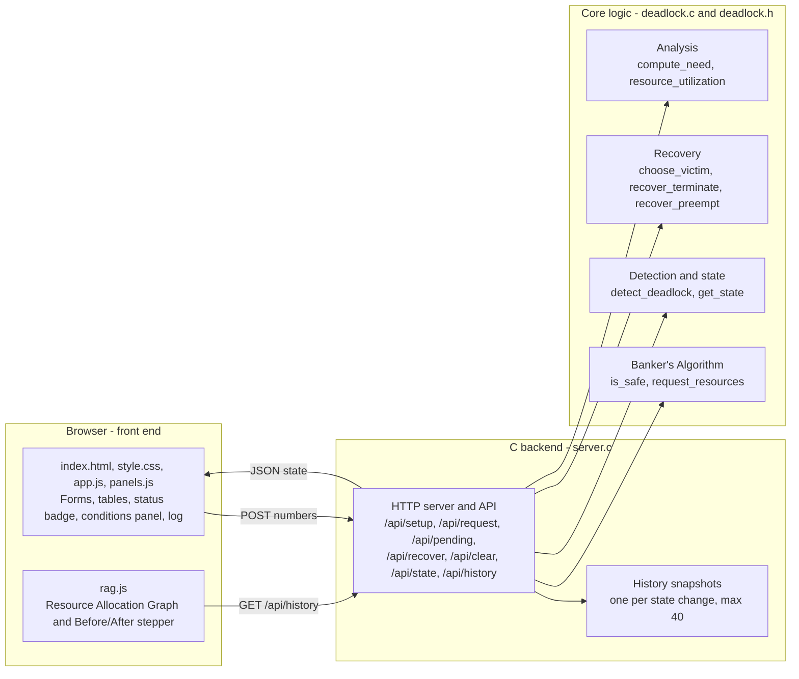
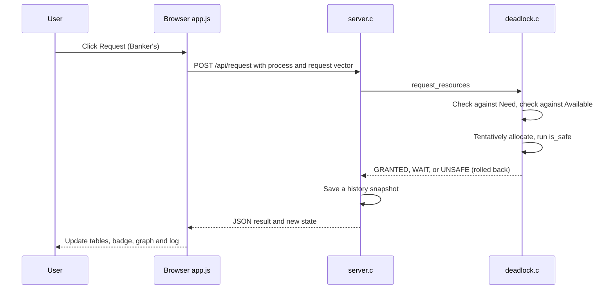

# Interactive Deadlock Simulation System

An interactive tool for learning how operating systems avoid, detect and recover from deadlocks. The core logic and the web server are written in **C**, with an **HTML front end** for the GUI.

It simulates:

- **Banker's Algorithm** for deadlock avoidance (safe / unsafe state checking and request validation)
- **Deadlock detection** for systems with pending (blocked) requests
- **Resource Allocation Graph (RAG)** visualization with Before / After navigation
- **Deadlock recovery** (terminate or preempt a victim process)
- **Four necessary conditions** panel (mutual exclusion, hold and wait, no preemption, circular wait)
- **Event log** with timestamps

---

## Features

| Feature | Description |
|---|---|
| Custom setup | Choose the number of processes and resources, then enter Total, Allocation and Maximum matrices |
| Sample loaders | One-click **Load safe sample** and **Load deadlock sample** |
| System state view | Live Available, Allocation, Maximum, Need and Pending Requests matrices, plus resource utilization bars |
| Banker's request | Rejects a request that exceeds the declared maximum, makes the process wait if resources are not available, and grants the request only if the system stays safe |
| Force pending | Marks a request as blocked so deadlock detection can be demonstrated |
| State classification | Reports the system as SAFE (with a safe sequence), UNSAFE, or DEADLOCKED (with the deadlocked processes) |
| RAG | Solid green edges = allocated, dashed orange edges = waiting, red processes = deadlocked |
| Recovery | Terminate or preempt an automatically chosen victim process |
| Log | Timestamped record of setups, granted and denied requests, and detected deadlocks |

---

## Architecture

The project has three layers. The browser only displays data, the C server connects the browser to the logic, and all the operating system algorithms live in a separate core module with no web code in it.



### What happens when a request is made



### Layer responsibilities

| Layer | Files | Responsibility |
|---|---|---|
| Core logic | `deadlock.h`, `deadlock.c` | Data structures and all algorithms. No web or GUI code, so it can be tested on its own |
| Tests | `test_main.c`, `test_edge.c` | Automatic checks of the core logic (textbook example, unsafe states, cycles, recovery) |
| Server | `server.c` | Small HTTP server in plain C. Serves the web files, calls the core functions, and returns the system state as JSON |
| Front end | `index.html`, `style.css`, `app.js`, `panels.js` | Input grids, state tables, action buttons, the four-conditions panel and the log. It never runs the algorithms |
| Graph | `rag.js` | Draws the Resource Allocation Graph from the allocation and request matrices and steps through earlier states |

The list of server endpoints is in `API.md`.

---

## How It Works

1. **Setup**: enter the number of processes and resources, then fill in the Total, Allocation and Maximum matrices (or load a sample) and click **Apply setup**.
2. **Inspect**: the system state panel shows `Need = Maximum − Allocation` and `Available = Total − Σ Allocation`.
3. **Request resources**: choose a process, enter the amounts, and click **Request (Banker's)**. The request is rejected if it exceeds the declared maximum, the process waits if the resources are not available, and it is denied if granting it would leave the system in an unsafe state.
4. **Run Banker's / Detect deadlock**: check for a safe sequence or for processes stuck in a circular wait.
5. **Recover**: choose *Terminate victim* or *Preempt victim* and click **Recover** to break the deadlock.
6. **Review**: use the RAG's **Before / After** buttons to step through changes, and read the log for the full history.

---

## Tech Stack

- **Logic and server:** C (Banker's Algorithm, deadlock detection, recovery, and a small HTTP server with no external libraries)
- **Front end:** HTML, CSS and JavaScript
- **Development and testing:** GitHub Codespaces

---

## Project Structure

```
week4/
├── deadlock.h, deadlock.c      # Core logic: Banker's, detection, recovery
├── test_main.c, test_edge.c    # Automated tests for the core logic
├── server.c                    # HTTP server and API
├── index.html, style.css       # Page layout and styling
├── app.js, panels.js           # UI logic, tables, conditions panel
├── rag.js                      # Resource Allocation Graph and Before/After stepper
├── API.md                      # List of server endpoints
├── DEMO_SCRIPT.md              # Demo walkthrough
└── Makefile
```
